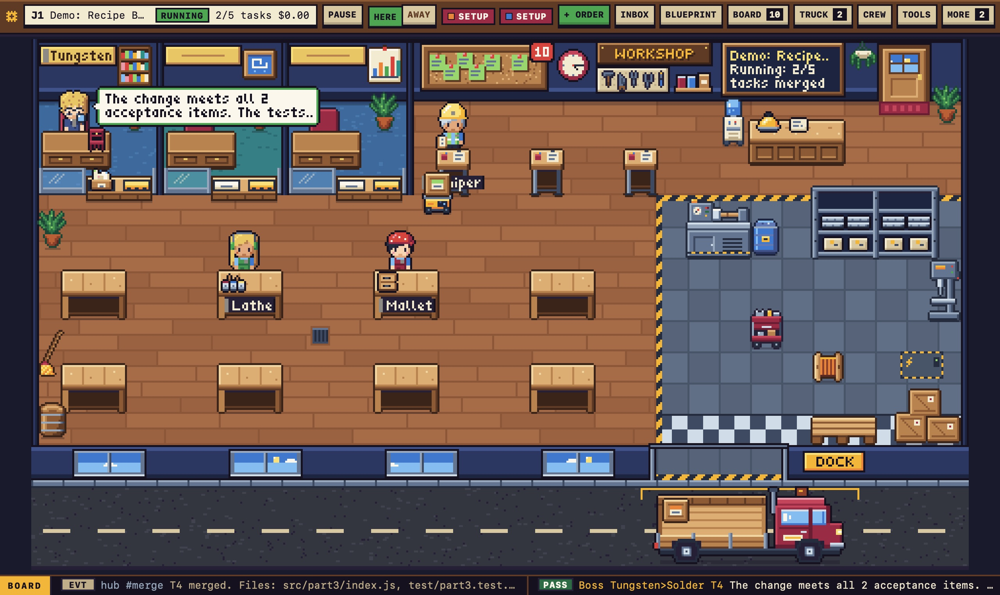
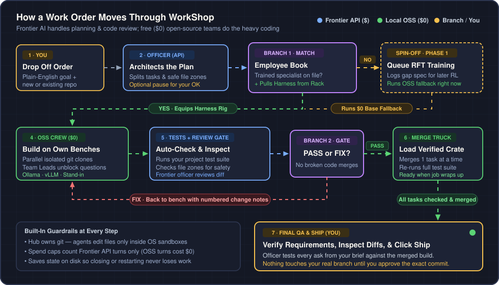
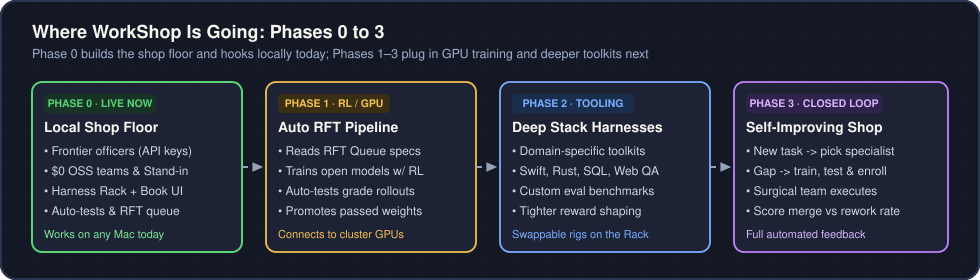

# WorkShop

**A local pixel-art coding workshop where a smart Frontier AI plans & inspects, and free open-source specialist teams do the heavy building.**



Running big coding projects purely on closed-source APIs burns through tokens fast — and piping automated agent loops through personal consumer subscriptions violates terms of service. WorkShop splits the job in two cleanly:

- **Orchestration Officers & Inspectors (Gemini / Claude, API key only):** Read your request, break it into safe parallel tasks, review the finished diffs, and run final QA. Because they only plan and inspect, your API spend stays small and predictable.
- **Specialist Agent Teams (Local OSS, $0):** Open-source models (via Ollama, vLLM, SGLang, llama.cpp, or the built-in Stand-in simulator) grab a modular toolkit from the **Harness Rack** and do the iterative coding on isolated git clones — costing **$0 per million tokens**.

---

## Try It in 60 Seconds

Zero API keys, zero GPUs, and zero `npm install` (WorkShop runs on Node 20+ built-ins only).

1. **Open the Mac app:** Double-click **`WorkShop.app`** (if macOS asks for Desktop access, click **Allow**), or launch the server directly with `npm start` and open the URL printed in your terminal.
2. **Run the demo:** Click **Run demo** on the welcome card. It runs a simulated build for free so you can watch specialists walk to benches, post updates on the board, load crates onto the truck, and test the **Approve & Ship** flow.

---

## How an Order Moves Through the Shop

<p align="center">
  
</p>

Here is what happens behind the scenes whenever you submit a **+ Work Order**:

1. **You drop off an order:** Describe what you want built in plain English, pick a new project or point at an existing git repo, and choose a team size.
2. **Frontier Officer plans it out:** A Gemini or Claude officer reads your codebase and turns your goal into a checklist of requirements, tasks, and strict **file zones** (so parallel builders never edit the same files at once). *If you checked "Pause for plan review", it waits here for your thumbs-up before anyone writes code.*
3. **Branch 1 — Employee Book check (`Roster`):** When assigning a task, the router checks your **Employee Book** for a trained specialist character matching that kind of work:
   - **Trained match found:** That character steps up to the bench and equips their **Harness Rig** (`.shop/HARNESS.md`) from the **Harness Rack**.
   - **No trained specialist yet:** Work doesn't stall — the job runs today using a capable `$0` base OSS model + harness, **and branches off a training requisition** into the **Phase 1 RFT Queue** so that specialty can be fine-tuned later.
4. **Parallel `$0` OSS benches:** Each task runs in its own isolated git clone inside an OS sandbox. Agents can only touch files in their assigned bench and can ask **Team Leads** or **you** questions (2–4 quick multiple-choice options) on the **Board**.
5. **Branch 2 — Automated checks & Review Gate:** When a specialist finishes, the hub runs your project's test command, checks that only allowed files changed, and hands the diff to a Frontier Reviewer:
   - **`FIX` branch:** If tests fail or something looks wrong, it bounces right back to the specialist's bench with numbered fix notes.
   - **`PASS` branch:** The hub merges that task one at a time, re-runs checks to verify the combined repo still passes, and loads a **crate** onto the **Merge Truck**.
6. **Final QA & Your Call:** Once all requirements pass, open **Truck**, inspect any diff line-by-line, and click **Approve & Ship** to fast-forward your real branch (`main`) cleanly. Nothing touches your branch until you approve that exact commit.

---

## Setting Up Models

Open **Runtimes** in the top bar (or use the **Quick setup** card on the floor). You only need **$0 OSS** plus **one** Frontier API key (Gemini or Claude) to run real jobs.

### Option 1: Built-in `$0` Stand-in Mode (No GPU Needed)
Great for testing custom harnesses, UI flows, and project setup on any laptop:
1. Open **Runtimes** -> find **Open-Source Specialist Runtime (`oss`)**.
2. Check **Enable Phase 0 Stand-in simulation ($0, no local GPU required)** and click **Save & Probe** (or click **Enable $0 Stand-in** right from the floor card).

### Option 2: Real Local Open-Source Models (`$0`) + 1 API Key
1. **Start an OpenAI-compatible local server** — for example with [Ollama](https://ollama.com):
   ```bash
   ollama pull qwen2.5-coder:32b
   ollama serve
   ```
   WorkShop defaults to `http://127.0.0.1:11434/v1` (supports Ollama, vLLM, SGLang, llama.cpp, or custom endpoints). Click **Save & Probe** in **Runtimes** to confirm detected models.
2. **Connect a Frontier Officer & Reviewer:** Under **Gemini (`agy`)** or **Claude (`claude`)** in **Runtimes**, click **Use API key**, paste your `GEMINI_API_KEY` or `ANTHROPIC_API_KEY` into the macOS Keychain section below (keys never touch logs or browser storage), click **Re-check**, and run the 1-click **Test**.

### Option 3: Set a Frontier Dollar Cap
In **+ Work Order** (and **Settings**), set **Frontier API budget in USD** (for example `5`). WorkShop only counts Frontier API-key turns against that cap — OSS specialist turns always cost `$0` — and automatically pauses the job for your approval if spending hits the limit.

---

## Automated Testing & Phases 1–3

Today's release is **Phase 0** — the complete local shop floor, Harness Rack, Employee Book, and RFT requisition queue — without downloading giant model weights or renting cloud GPUs yet.

<p align="center">
  
</p>

### How Automated Tests Fit Into Phases 1, 2, and 3
- **Today (Phase 0):** Every project sets a verification command (`checkCmd`, like `npm test` or `cargo test`) on its Blueprint. The hub runs it before work starts (baseline), on every hand-in before review, and after every sequential merge onto the truck. If you edit the repo manually, you can also trigger tests anytime from **Harnesses -> Project Tools**.
- **Phase 1 (Automated RL / RFT Pipeline):** When an order hits a specialty gap in Phase 0, WorkShop saves a structured requisition (`TR1`, `TR2`, ...) listing the target base model, **Harness Rack** toolkit, and **reward signals** (like `check_cmd_exit_zero`, `diff_minimality`, and `zero_hub_path_touch`). A Phase 1 GPU trainer will pull that queue and use your automated test suite directly as the verifiable RL grader before promoting a new fine-tuned checkpoint.
- **Phase 2 (Specialized Software Harnesses):** Expands `config/harnesses.json` beyond core roles into deep stack-specific rigs (Swift/macOS, Rust, SQL/data pipelines, browser QA) paired with custom linters and synthetic test suites.
- **Phase 3 (Closed-Loop Specialist Shop):** Connects the entire pipeline end-to-end: drop off a problem -> Officer picks a certified specialist (or auto-trains & verifies a new one on a gap) -> agent team builds & validates -> long-run merge vs. rework stats automatically retire or re-calibrate weak rigs.

*See [docs/ROADMAP.md](docs/ROADMAP.md) for the fuller breakdown of the architecture across Phases 0–3.*

---

## Quick Tour of the App

| Button / Floor Prop | What you do there |
|---|---|
| **+ Work Order** *(front counter)* | Start a job, adjust team size, set a Frontier dollar cap, or run the demo |
| **Inbox** | Everything waiting on you in one place: owner questions, plan approvals, paused jobs, or a ready truck |
| **Blueprint** | Live progress: checklist of requirements, tasks grouped by status, baseline check results, pause/resume |
| **Board** | Filtered feed of agent questions, hand-ins, and review notes; reply directly to any agent |
| **Truck** | Diff-by-diff inspection of verified work, final report, and 1-click **Approve & Ship** |
| **Roster** *(RFT bay)* | Live **Active Team**, persistent **Employee Book** (`config/roster.json`), and **RFT Queue** |
| **Harnesses** *(wall rack / pegboard)* | Inspect & edit modular `.shop/HARNESS.md` rigs on the **Harness Rack**, or run one-click **Project Tools** |
| **Models** | Browse benchmark scores, toggle active models, and view domain leaders |
| **Runtimes** | Switch between OSS Stand-in and Ollama/vLLM, connect Frontier API keys, and run sandbox self-tests |
| **Settings** | Presence timeout (**Here / Away** toggle in top bar), crew presets, cross-lab review toggles, sandbox mode |

---

## Requirements & Handy Commands

- **macOS 14+** (for `WorkShop.app` / Keychain), **Node.js 20+**, and **git**.
- Optional for live Frontier Officers: **Antigravity CLI** (`agy`) and/or **Claude Code CLI** (`claude`) in API-key mode.

```bash
# Start the hub server directly (prints your local browser URL)
npm start

# Start a scratch sandbox hub with the built-in mock runtime only
node server/index.js --labs mock --secrets file --port 0 --data /tmp/ws/data --config /tmp/ws/config --projects /tmp/ws/projects

# Run the automated test suite (no external tokens used)
npm test

# Rebuild WorkShop.app after modifying macapp/ Swift sources (requires Command Line Tools)
bash macapp/build.sh
```

<details>
<summary>Quick troubleshooting & project folders</summary>

- **Folders:** `WorkShop.app` (Mac launcher), `server/` (hub & runtimes), `ui/` (browser UI & 16-bit scene), `config/` (`models.json`, `harnesses.json`, `roster.json`), `data/` (local state, logs, task clones — git-ignored), `projects/` (new repos), `tests/` (`node --test` suites).
- **Job stuck in `queued`?** No Frontier Officer runtime is ready yet — open **Runtimes**, save one Gemini/Claude API key (or check **Run demo** for zero-key testing).
- **Job `paused` after closing or restarting?** Safe restarts pause active jobs automatically; open **Blueprint** and click **Resume**.
- **Page says `Locked`?** Re-open from **`WorkShop.app`** or use the full URL containing `#k=...` printed by `npm start`.
- **Want a fresh slate?** Quit WorkShop and delete `data/` (your `projects/`, `config/`, and macOS Keychain keys stay untouched).
- **Logs:** `data/logs/hub.log`, `data/logs/launcher.log`, and per-agent logs in `Roster`.

</details>
